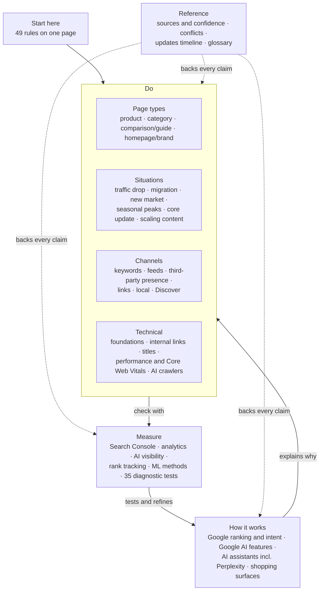
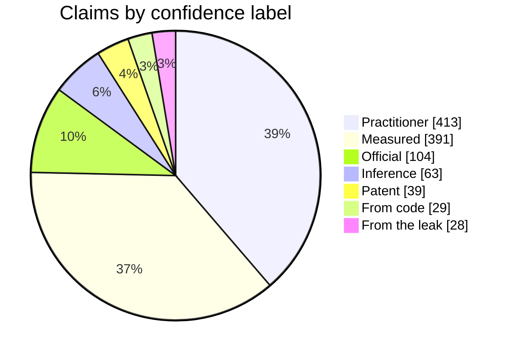
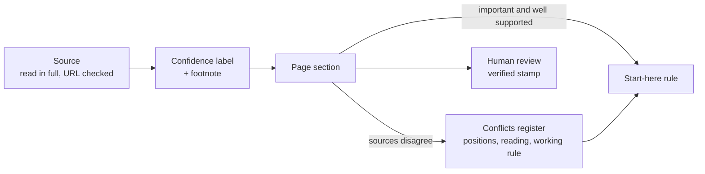

# SEO / GEO Playbook

A sourced knowledge base for search (SEO) and AI-search visibility (GEO), written for ecommerce and kept brand-neutral. It covers how Google, AI assistants (ChatGPT, Gemini, Claude, Perplexity, Copilot) and shopping surfaces find, rank and cite pages, what to do about it, and how to measure the result without fooling yourself.

You can drop it into any project as a reference that you or your AI agent can rely on. Every claim cites its source and says how strong the evidence is. Where sources disagree, the disagreement is written down instead of quietly settled.

- **36 pages** grouped by task: page types, situations, channels, technical, measurement
- **49 rules** on one page ([start here](playbook/start-here.md)), each linked to its evidence
- **35 diagnostic tests** you can repeat on your own data
- **28 conflicts** where sources disagree, each with the positions, a reading and a working rule
- **~450 footnoted sources**: vendor documentation from Google, OpenAI, Anthropic and others; Google's web.dev performance course; measured studies and clickstream panels; leak and trial documents; patents; and practitioner research on SEO, analytics, performance and machine-learning methods

## How the topics fit together



- **Do**: what to change, organised the way work arrives. You either work on a kind of page, deal with a situation, run a channel or fix the technical setup. Each page opens with its rules, then a checklist or steps.
- **How it works**: the evidence behind the rules. It covers:
  - how Google ranks and reads intent
  - how AI Overviews and AI Mode pick sources
  - how assistants, Perplexity's own index included, retrieve and cite
  - how shopping surfaces use product data
- **Measure**: how to read Search Console, analytics, behavioural and AI-visibility data correctly, including:
  - zero-click rates and margins of error
  - AI traffic hiding in Direct
  - machine-learning methods for clustering, audits and redirect maps
  - repeatable tests that tell you whether a rule holds on your site
- **Reference**: the source list with a reliability label for each source, the conflicts register, a timeline of Google updates from 2023 to 2026, and a glossary.

## How strong is the evidence?

Every claim carries one of seven confidence labels. Across the playbook, they break down like this:



Most rules rest on measured studies or practitioner experience, and many measured studies come from vendors who sell a related tool; the label says so (*vendor data*). Official documentation tells you what a vendor says its systems do, not what works best. Leak, code and patent claims name real mechanisms whose current weight is unknown.



## Add it to your setup

1. Copy the `playbook/` folder into your project, or add this repository as a git submodule.
2. Tell your agent where it is. For example, add this to `CLAUDE.md`, `AGENTS.md`, Cursor rules or your system prompt:

   ```markdown
   ## SEO / GEO reference
   For questions about SEO, AI-search visibility or search measurement, read
   `playbook/index.md` first, then `playbook/start-here.md`, then only the pages you need.
   - Cite the playbook pages you used.
   - Keep each claim's confidence label; don't present inference or practitioner advice as fact.
   - Where a page links to `reference/conflicts.md`, give both positions.
   - Treat every rule as a hypothesis to test on this site's own data.
   ```

3. People can read it too. It is plain Markdown with relative links, so it works on GitHub, in any editor, in Obsidian or in a docs site.

## How to read a page

Each page is a Markdown file with YAML frontmatter that follows the Open Knowledge Format (OKF) v0.2:

```yaml
type: Playbook                 # or Guide, Checklist, Reference, Timeline
title: Category pages
description: One line, also used in the folder index.
status: stable                 # draft | stable | deprecated
generated: { by: …, at: 2026-10-29T08:30:00Z }
verified: { by: human:…, at: 2026-10-29T08:47:00Z }   # last human review

stale_after: 2027-04-28T00:00:00Z   # re-check after this date
sources:
  - id: g-pagination
    resource: "https://developers.google.com/search/docs/…"
    title: Google, pagination and incremental loading
```

The body follows the same order on every page:
1. One sentence on what the page covers.
2. **Rules**, at most about 11.
3. Numbered sections with the evidence.
4. A checklist or steps.
5. Footnotes. Each `[^id]` resolves to an entry in `sources`.

Every claim carries a **confidence label**:

| Label | Meaning |
|---|---|
| Official | Stated in a vendor's own documentation or by its staff |
| Measured | A study or test with stated data and method |
| From code | Read from shipped code or network traffic |
| From the leak | The 2024 Google API leak or US trial exhibits. The names are real; their current weight is unknown |
| Patent | Described in a patent. It doesn't prove the method is in use |
| Practitioner | Experience from consultants and agencies, without published data |
| Inference | Our own reasoning from the above |

Qualifiers such as *vendor data*, *relayed*, *one case* and *small sample* narrow a label further. [Sources and confidence](playbook/reference/sources-and-confidence.md) lists every source with its label, and says which sources and claims were left out on purpose.

## Scope and limits

- **A snapshot.** The content reflects sources up to **October 2026**. Search changes fast, so each page carries a `stale_after` date and the [log](playbook/log.md) records what changed.
- **Reviewed, not guaranteed.** Every page is `stable` and was reviewed by a person after its last change (`verified`, 29 October 2026). The rules are still well-sourced hypotheses: test them on your own data before acting at scale.
- **Ecommerce first.** Most of it also applies to publishers, local businesses and SaaS, but the examples and priorities are written for online shops.
- **Anonymised examples.** The examples come from one German-market online shop (2024–2026). Brand, product and identifying figures have been removed.
- **Not affiliated** with Google, OpenAI, Anthropic or any source cited. All trademarks belong to their owners. Quotes are short and attributed; for the full argument, follow the footnote to the original.

## Contributing

Corrections and new sources are welcome. Please keep to the conventions:

- Cite every number and every non-obvious claim with a footnote whose id appears in the page's `sources`.
- Label the confidence of each claim.
- Don't silently overwrite a claim that conflicts with yours. Add both positions to [the conflicts register](playbook/reference/conflicts.md) and a one-line pointer on the page.
- Update existing pages rather than adding near-duplicates, and record what changed in [log.md](playbook/log.md).
- A change of substance removes the page's `verified` stamp until a person reviews it again. Only a person adds `verified`.
- Use relative links between pages. Don't renumber `## n.` sections, because other pages link to their anchors.
- Keep it brand-neutral: no client, shop or product specifics.

## License

The playbook is licensed under [Creative Commons Attribution 4.0 International (CC BY 4.0)](LICENSE). You may copy, adapt and share it, commercially too, as long as you credit it, for example "Based on the SEO / GEO Playbook (CC BY 4.0)" with a link to this repository, and say whether you changed it. The license covers this playbook's own text. Short quotes and figures from cited sources remain their authors' work.
